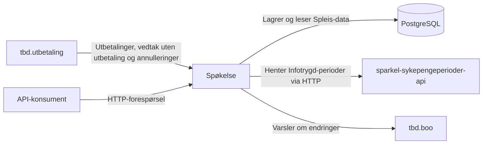

# Spøkelse

Spøkelse deler informasjon om utbetalte sykepengeperioder og gjenstående sykedager fra Spleis og Infotrygd gjennom et HTTP-API.

[](https://github.com/navikt/helse-spokelse/actions/workflows/main.yml)

## Kom i gang

Du trenger JDK 25 og Docker. Start Docker før du kjører testene, som bruker PostgreSQL i containere.

Kjør fra roten av repoet:

```bash
./gradlew test
./gradlew build
```

Applikasjonen er skrevet i Kotlin og bruker Ktor, Rapids and Rivers og PostgreSQL. Flyway kjører databasemigreringene ved oppstart.
Testene setter opp egne testdatabaser. De krever ikke at du starter hele applikasjonen med Kafka og Azure AD.

Repoet har ikke et ferdig oppsett for å kjøre hele applikasjonen lokalt. Det krever PostgreSQL, Kafka med SSL,
Azure AD-konfigurasjon og tilgang til Infotrygd-API-et. Se [konfigurasjon](#konfigurasjon) før du starter
`no.nav.helse.spokelse.AppKt`.

## Dataflyt

Spøkelse lagrer utbetalinger, vedtak uten utbetaling og annulleringer fra Spleis i egen database. Ved forespørsler om utbetalte perioder
kombinerer den disse med eldre Spleis-utbetalinger og perioder hentet fra Infotrygd.



Spøkelse lytter også på `tbd.rapid.v1`, blant annet etter varsler om nye opplysninger i Infotrygd.
Den publiserer endringsvarsler på `tbd.boo` ved utbetalinger, annulleringer og nye Infotrygd-opplysninger.

Eldre Spleis-utbetalinger kommer fra tiden før overgangen til `tbd.utbetaling` i oktober 2022. Før det leste
Spøkelse fra den interne rapiden. Disse utbetalingene får ikke nye data, men brukes fortsatt ved oppslag.
Annulleringer av eldre utbetalinger lagres i tabellen `alle_annulleringer`. Den har alle annulleringene fra
den interne rapiden, og nye annulleringer fra `tbd.utbetaling` legges også inn der.

## API og tilgang

Alle endepunktene nedenfor krever et Azure AD-token for en applikasjon med riktig rolle.
Konsumenten må også ha tilgang gjennom Nais access policy.

| Metode | Endepunkt | Innhold | Påkrevd rolle |
|--------|-----------|---------|---------------|
| POST | `/grunnlag` | Utbetalinger fra Spleis, inkludert eldre utbetalinger, for Foreldrepenger og K9, direkte og via Abakus | `foreldrepenger-les` eller `k9-les` |
| POST | `/utbetalte-perioder` | Perioder fra Spleis og Infotrygd med valgfri gruppering, brukes av [Spapi](https://github.com/navikt/helse-spapi) | `spleiselaget-les` |
| POST | `/utbetalte-perioder-aap` | Perioder gruppert etter grad, uten tags | `aap-les` |
| POST | `/utbetalte-perioder-dagpenger` | Perioder gruppert etter grad, uten tags | `dagpenger-les` |
| POST | `/utbetalte-perioder-personoversikt` | Perioder gruppert etter grad, organisasjonsnummer og kilde, med tags | `personoversikt-les` |
| POST | `/gjenstaende-sykedager` | Gjenstående sykedager fra siste vedtak i Spleis | `aap-les` |

Se [rutene for utbetalte perioder](src/main/kotlin/no/nav/helse/spokelse/utbetalteperioder/UtbetaltePerioderApi.kt),
[grupperingsreglene](src/main/kotlin/no/nav/helse/spokelse/utbetalteperioder/Gruppering.kt) og
[ruten for grunnlag](src/main/kotlin/no/nav/helse/spokelse/grunnlag/GrunnlagApi.kt) for request- og response-format.

### Gjenstående sykedager

`/gjenstaende-sykedager` tar imot `{"fødselsnummer": "<11 siffer>"}` og svarer med antall gjenstående sykedager
og datoen tallet gjelder til og med. Tallet gjelder per siste vedtak, ikke per i dag. Hvis Infotrygd har en utbetaling
etter siste vedtak, svarer endepunktet `404` med feilkoden `SISTE_UTBETALING_I_INFOTRYGD`.

OpenAPI-specen ligger på `/openapi/gjenstaende-sykedager.yml`, og Swagger UI på `/swagger`. Begge er åpne uten token:
[dev](https://spokelse.intern.dev.nav.no/swagger) og [prod](https://spokelse.intern.nav.no/swagger).
Specen beskriver svarkodene, feilkodene og hva tallet ikke tar hensyn til.

Vedtakene lagres i tabellen `gjenstående_sykedager`. Vedtak fra før endepunktet kom, er fylt inn fra råmeldingene
i `tbdUtbetaling_Melding` med migreringen `V20`.

## Konfigurasjon

| Miljøvariabel | Bruk | Påkrevd | Standardverdi |
|---------------|------|---------|---------------|
| `INFOTRYGD_URL` | URL til `sparkel-sykepengeperioder-api` | Ja | Ingen |
| `INFOTRYGD_SCOPE` | Azure AD-scope for Infotrygd-API-et | Ja | Ingen |

Nais setter database-, Kafka- og Azure AD-variablene. Ved lokal oppstart må du sette dem selv.
De konkrete variablene leses i [App.kt](src/main/kotlin/no/nav/helse/spokelse/App.kt),
[DataSourceBuilder.kt](src/main/kotlin/no/nav/helse/spokelse/DataSourceBuilder.kt),
[TbdUtbetalingConsumer.kt](src/main/kotlin/no/nav/helse/spokelse/tbdutbetaling/TbdUtbetalingConsumer.kt) og
[AccessToken.kt](src/main/kotlin/no/nav/helse/spokelse/utbetalteperioder/AccessToken.kt).

## Deploy og drift

[Hovedworkflowen](.github/workflows/main.yml) bygger, tester og lager image med Jib.
Ved kodeendringer på `main` deployer den til både `dev-gcp` og `prod-gcp` i namespacet `tbd`.
Workflowen kjører også ukentlig og kan startes manuelt. Rene dokumentasjonsendringer utløser ikke deploy.

Felles Nais-oppsett ligger i [spokelse.yaml](.nais/spokelse.yaml), med miljøspesifikke mixins for
[dev](.nais/spokelse.dev-gcp.yaml) og [prod](.nais/spokelse.prod-gcp.yaml).
[Topic-workflowen](.github/workflows/topics.yml) deployer konfigurasjonen for `tbd.boo` separat.

Applikasjonen lytter på port `8080`. Nais bruker `/isalive` og `/isready` til helsesjekker og
henter Prometheus-metrikker fra `/metrics`. Logger sendes til Elastic og Loki.

## Eierskap og kontakt

[@navikt/team-sas](https://github.com/orgs/navikt/teams/team-sas) eier koden.
Opprett et issue i repoet ved spørsmål om koden. Nav-ansatte kan også spørre i Slack-kanalen `#område-helse`.

## Lisens

[MIT](LICENSE).
