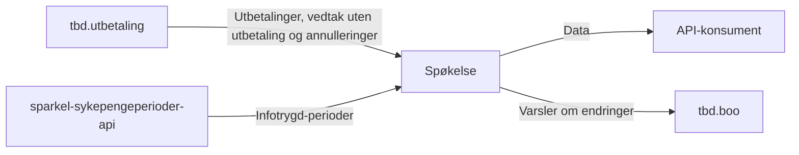

# Spøkelse

Spøkelse deler informasjon om utbetalte sykepengeperioder og gjenstående sykedager fra Spleis og Infotrygd gjennom et HTTP-API.

[Swagger Doc](https://spokelse.intern.nav.no/swagger)

## Dataflyt

Spøkelse lagrer utbetalinger, vedtak uten utbetaling og annulleringer fra Spleis i egen database. Ved forespørsler om utbetalte perioder
kombinerer den disse med eldre Spleis-utbetalinger og perioder hentet fra Infotrygd.

Spøkelse lytter også på `tbd.rapid.v1`, blant annet etter varsler om nye opplysninger i Infotrygd.
Den publiserer endringsvarsler på `tbd.boo` ved utbetalinger, annulleringer og nye Infotrygd-opplysninger.

Eldre Spleis-utbetalinger kommer fra tiden før overgangen til `tbd.utbetaling` i oktober 2022. Før det leste
Spøkelse fra den interne rapiden. Disse utbetalingene får ikke nye data, men brukes fortsatt ved oppslag.
Annulleringer av eldre utbetalinger lagres i tabellen `alle_annulleringer`. Den har alle annulleringene fra
den interne rapiden, og nye annulleringer fra `tbd.utbetaling` legges også inn der.

## Henvendelser

Spørsmål knyttet til koden eller prosjektet kan stilles som issues her på GitHub.

### For NAV-ansatte

Interne henvendelser kan sendes via Slack i
kanalen [#team-sas-værsågod](https://nav-it.slack.com/archives/C019637N90X).

## Kode generert av GitHub Copilot

I dette repoet brukes GitHub Copilot til å generere kode.
